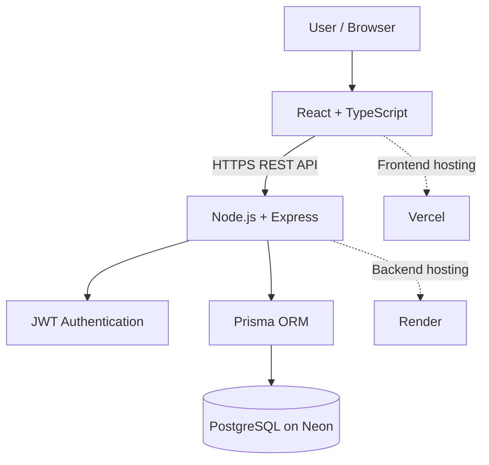

# 🛡️ SAFENET — Personal Safety & Women's Safety Platform

<p align="center">
  <strong>A full-stack safety platform designed to help users manage trusted contacts, perform safety check-ins, and document safety-related incidents.</strong>
</p>

<p align="center">
  <a href="https://safenet-cjn65xp6r-gaurangi-vijay-kapares-projects.vercel.app">🚀 Live Demo</a> •
  <a href="https://github.com/Gaurangi2904/Safenet">📂 Source Code</a> •
  <a href="https://safenet-backend-d0a8.onrender.com/api/v1/health">⚙️ API Health</a>
</p>

<p align="center">
  
  
  
  
  
  
</p>

---

## 📌 Overview

SAFENET is a full-stack web application built to bring essential personal-safety tools together in one place. It provides a centralized dashboard where authenticated users can manage trusted contacts, record safety check-ins, and submit safety-related incident reports.

The project demonstrates end-to-end application development, including frontend engineering, REST API integration, authentication, relational database management, schema migrations, and cloud deployment.

## 🎯 Problem Statement

Personal-safety information and emergency preparedness tools can be fragmented across different applications and manual processes. Users may benefit from having trusted contacts, safety records, and incident documentation accessible through a single interface.

## 💡 Proposed Solution

SAFENET provides a centralized web platform that allows users to:

- Create an account and securely authenticate.
- Maintain a list of trusted contacts.
- Record safety check-ins.
- Document safety-related incidents.
- Access safety features from a unified dashboard.

## ✨ Key Features

| Feature | Description |
|---|---|
| 🔐 Authentication | User registration, login, and token-based authentication. |
| 📊 Safety Dashboard | Centralized access to the application's safety modules. |
| 👥 Trusted Contacts | Add and manage trusted people. |
| ✅ Safety Check-Ins | Submit and save safety check-in records. |
| 📝 Incident Reporting | Create and retain safety-related incident reports. |
| 🆘 SOS Module | Access the application's emergency-related functionality. |
| 🗄️ Persistent Storage | Store application data in PostgreSQL using Prisma. |
| ☁️ Cloud Deployment | Deploy the frontend, backend, and database using separate services. |

> **Implementation note:** Real emergency notifications, automatic location sharing, and third-party emergency-service integrations should only be considered available if they are implemented and verified in the deployed application.

## 🖥️ Live Application

**Try SAFENET:** [Open the live website](https://safenet-cjn65xp6r-gaurangi-vijay-kapares-projects.vercel.app)

The deployed application has been tested for account access, dashboard loading, trusted-contact persistence, safety check-ins, and incident reporting.

## 🧰 Technology Stack

| Component | Technologies |
|---|---|
| Frontend | React, TypeScript, Vite |
| Backend | Node.js, Express.js, TypeScript |
| API | REST API |
| Authentication | JSON Web Tokens (JWT), bcrypt |
| Database | PostgreSQL, Neon |
| ORM | Prisma |
| Frontend Hosting | Vercel |
| Backend Hosting | Render |
| Version Control | Git, GitHub |
| Development & Infrastructure | Docker, Kubernetes |

## 🏗️ System Architecture



### Application Flow

1. The user interacts with the React frontend.
2. The frontend sends HTTP requests to the Express API.
3. Authentication middleware protects authorized endpoints.
4. Prisma communicates with the PostgreSQL database.
5. The API returns responses to the frontend, which updates the interface.

## 📂 Project Structure

```text
Safenet/
├── client/
│   ├── public/
│   ├── src/
│   │   ├── api/
│   │   └── ...
│   ├── package.json
│   └── vite.config.ts
│
├── server/
│   ├── prisma/
│   │   ├── migrations/
│   │   └── schema.prisma
│   ├── src/
│   │   ├── routes/
│   │   └── ...
│   ├── package.json
│   └── prisma7.config.ts
│
└── README.md
```

## ⚙️ Local Setup

### Prerequisites

- Node.js and npm
- Git
- PostgreSQL database or a compatible PostgreSQL connection

### 1. Clone the repository

```bash
git clone https://github.com/Gaurangi2904/Safenet.git
cd Safenet
```

### 2. Configure the backend

```bash
cd server
npm install
```

Create `server/.env`:

```env
DATABASE_URL="YOUR_POSTGRESQL_CONNECTION_STRING"
JWT_SECRET="YOUR_SECRET_VALUE"
PORT=5000
```

Use your own database connection string and a strong secret. Never commit `.env` files or credentials to GitHub.

### 3. Generate the database client

```bash
npx prisma generate
```

Apply the existing migrations to the database configured by `DATABASE_URL`:

```bash
npx prisma migrate deploy
```

**Important:** This command applies migrations to the selected database. Use it only when `DATABASE_URL` points to the intended database.

### 4. Start the backend

```bash
npm run dev
```

The local backend is expected to run on port `5000`, unless configured otherwise.

### 5. Configure the frontend

Open a second terminal:

```bash
cd client
npm install
```

Create `client/.env`:

```env
VITE_API_URL=http://localhost:5000/api/v1
```

Start the frontend:

```bash
npm run dev
```

Open the local development URL shown in your terminal.

## ☁️ Deployment

SAFENET uses a separated frontend and backend deployment architecture:

- **Vercel** hosts the frontend.
- **Render** runs the backend API.
- **Neon** provides managed PostgreSQL storage.

The frontend API base URL is configured through `VITE_API_URL`. Backend secrets and database credentials are configured as environment variables on the backend hosting service.

## 🔒 Security Considerations

- Passwords are hashed before storage.
- Protected routes require authentication.
- Secrets and database credentials should remain outside version control.
- Sensitive personal information should be handled carefully.
- Emergency-related features must be tested without triggering real emergency responses.

## 🚀 Potential Future Enhancements

- Real-time emergency notifications.
- Consent-based live location sharing.
- Integration with verified emergency-service providers.
- Additional automated testing and monitoring.
- CI/CD workflows for consistent deployments.
- Enhanced accessibility and mobile experience.

These items are potential enhancements, not claims of existing functionality.

## 👩‍💻 Developer

**Gaurangi Kapare**  
BE Information Technology | Full-Stack Development

- **GitHub:** [Gaurangi2904](https://github.com/Gaurangi2904)
- **Project:** [SAFENET Repository](https://github.com/Gaurangi2904/Safenet)
- **Live Demo:** [SAFENET](https://safenet-cjn65xp6r-gaurangi-vijay-kapares-projects.vercel.app)

---

<p align="center">
  <strong>SAFENET — Building technology for a safer digital experience.</strong>
</p>

<p align="center">
  <sub>Developed as an educational full-stack software engineering project.</sub>
</p>
