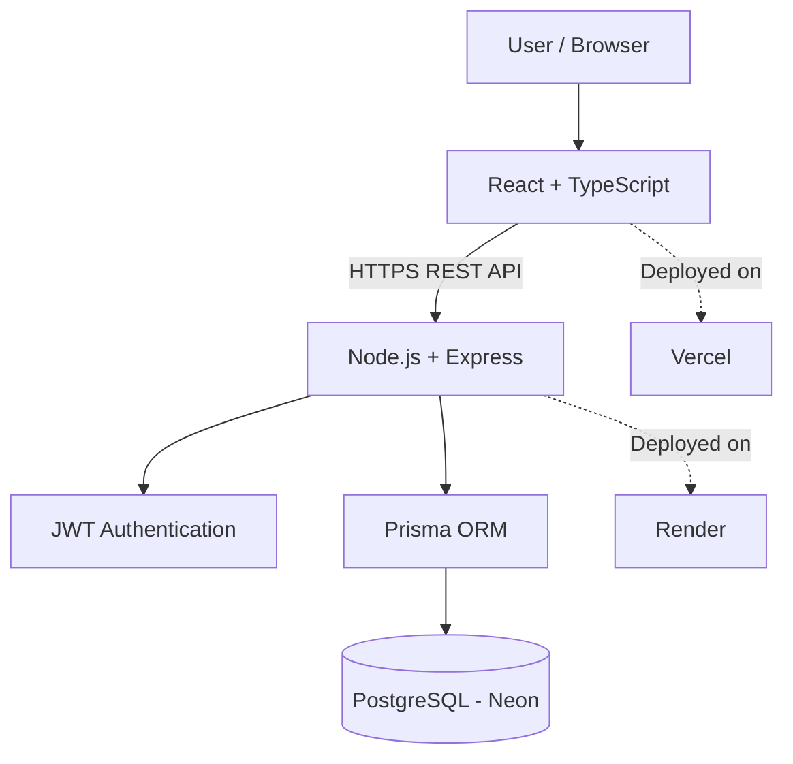

# 🛡️ SAFENET — Women's Safety Platform

  <strong>A Full-Stack Web Application for Personal Safety and Emergency Preparedness</strong>

  <a href="https://safenet-cjn65xp6r-gaurangi-vijay-kapares-projects.vercel.app">🌐 Live Demo</a> •
  <a href="https://github.com/Gaurangi2904/Safenet">📂 GitHub Repository</a> •
  <a href="https://safenet-backend-d0a8.onrender.com/api/v1/health">⚙️ Backend Health</a>

  
  
  
  
  
  

---

## 📌 About the Project

**SAFENET** is a full-stack women's safety platform designed to bring essential personal-safety features together in one centralized web application.

The platform allows authenticated users to manage trusted contacts, record safety check-ins, report incidents, and access safety-related functionality through a centralized dashboard.

The project demonstrates practical experience in full-stack development, REST API integration, authentication, database management, and cloud deployment.

## 🎯 Problem Statement

Personal-safety information and tools can be scattered across different applications and manual processes. This can make it harder for users to organize trusted contacts and maintain records of safety-related activities.

SAFENET aims to simplify access to these features through a single, user-friendly platform.

## 💡 Proposed Solution

SAFENET provides a centralized web interface that connects the frontend, backend APIs, and a persistent database. Users can manage their safety-related information and access available features from one place.

## ✨ Key Features

- 🔐 **User Authentication** — Registration, login, password hashing, and JWT-based authentication.
- 📊 **Safety Dashboard** — Centralized access to the platform's safety modules.
- 👥 **Trusted Contacts** — Add and manage trusted contacts.
- ✅ **Safety Check-Ins** — Create and save safety check-in records.
- 📝 **Incident Reporting** — Submit and store safety-related incident reports.
- 🆘 **SOS Module** — Access the application's emergency-related functionality.
- 🗄️ **Database Integration** — Persistent storage using PostgreSQL and Prisma ORM.
- ☁️ **Cloud Deployment** — Frontend and backend hosted separately for deployment flexibility.

## 🧰 Technology Stack

| Category | Technologies |
|---|---|
| Frontend | React, TypeScript, Vite |
| Backend | Node.js, Express.js, TypeScript |
| API | REST API |
| Authentication | JWT, bcrypt |
| Database | PostgreSQL, Neon |
| ORM | Prisma |
| Frontend Hosting | Vercel |
| Backend Hosting | Render |
| Version Control | Git, GitHub |
| Infrastructure Tools | Docker, Kubernetes |

## 🏗️ System Architecture

### Application Workflow

1. Users interact with the React frontend.
2. The frontend communicates with the backend through REST APIs.
3. The backend handles requests and authenticates access to protected endpoints.
4. Prisma ORM manages database operations.
5. PostgreSQL stores application data.

## 🔒 Security Highlights

- Password hashing with bcrypt.
- JWT-based authentication for protected routes.
- Environment variables for sensitive configuration.
- Separation of frontend, backend, and database responsibilities.

## 🚀 Future Enhancements

- Real-time emergency notifications.
- Consent-based live location sharing.
- Integration with verified emergency-service providers.
- Automated testing and CI/CD improvements.
- Enhanced mobile responsiveness and accessibility.

*These are planned enhancements and are not claims of existing functionality.*

## 👩‍💻 Developer

**Gaurangi Kapare**  
BE Information Technology | Full-Stack Development

- GitHub: [@Gaurangi2904](https://github.com/Gaurangi2904)
- Project Repository: [SAFENET](https://github.com/Gaurangi2904/Safenet)
- Live Demo: [Explore SAFENET](https://safenet-cjn65xp6r-gaurangi-vijay-kapares-projects.vercel.app)

---

  <strong>SAFENET — Building technology for a safer digital experience. 🛡️</strong>

  Developed as an educational full-stack software engineering project.

